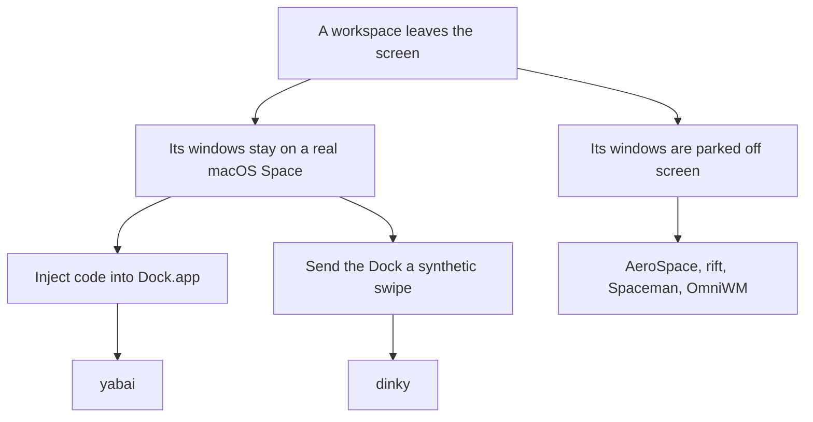

import tierList from "../../../../public/images/blog/macos-tiling-window-managers/tier-list.webp";

I have run six tiling window managers on macOS: yabai with skhd, AeroSpace,
rift, OmniWM, Spaceman, and dinky. dinky is the one I use today. It feels like a
part of macOS that was missing.

The short version is a
<SourceLink href="https://x.com/exsesx/status/2125644566011265072">tier list on X</SourceLink>.
This is the long one: where each tool sits, and the engineering decision that
put it there.

<Figure
  src={tierList}
  alt="Tier list of macOS tiling window managers: dinky in S, rift and Spaceman in A, AeroSpace and yabai in B, nothing in C, OmniWM in D"
  caption="My ranking on November 25, 2026. It answers one question: what would I run today?"
  frame="intrinsic"
  priority
/>

<Callout title="What I checked, and when" variant="note">
  I ran dinky `0.31`, Spaceman `0.3.5`, rift `0.8.6`, and AeroSpace `0.21.3-Beta`
  side by side on macOS `27.2.1` with one shared keymap. yabai and OmniWM are
  ranked from earlier use. Repository numbers, source links, and quotes are from
  November 25, 2026.
</Callout>

## The ranking

| Tier | Tool            | Why it sits there                                                            |
| ---- | --------------- | ---------------------------------------------------------------------------- |
| S    | dinky           | Tiles real macOS Spaces, switches them fast, and leaves SIP on               |
| A    | rift            | Fast and capable, with the widest layout choice of the virtual-workspace set |
| A    | Spaceman        | The shortcut model I like most, with careful handling of edge cases          |
| B    | AeroSpace       | Made virtual workspaces popular. Newer tools have built on its idea          |
| B    | yabai with skhd | The original power tool. Its best features still ask you to weaken SIP       |
| D    | OmniWM          | Capable, but it tries to be an entire desktop shell                          |

This ranks daily drivers, not importance. yabai and AeroSpace paved the way for
everything above them, and dinky's credits list both by name.

## One question sorts all six

When a workspace is not on screen, where do its windows go?

macOS has its own answer, Spaces, but no public way to control them. AeroSpace's
guide says it plainly:
<SourceLink href="https://nikitabobko.github.io/AeroSpace/guide#emulation-of-virtual-workspaces">"Apple doesn't provide public API to communicate with Spaces."</SourceLink>
Every tool here is a way around that sentence.

Parking is a trick with a visible seam. macOS refuses to move a window fully off
screen, so every hidden window keeps a one-pixel sliver at a bottom corner of
your display. Switching workspaces shuffles windows in and out of that corner.
It is instant, because all it asks of macOS is a move. But as far as macOS
knows, everything still lives on one desktop. Mission Control shows every window
from every workspace at once, and a window manager that crashes leaves its
windows stranded off screen.

A real Space has no seam. The windows are on another desktop, nothing waits in a
corner, and Mission Control and Cmd-Tab agree with you about where things are.
The catch is that Spaces belong to the Dock, so you either get inside the Dock
or persuade it.

Each branch has its own price:

| Tool      | Workspaces    | SIP                          | Private APIs                           | Language       | First release  |  Stars |
| --------- | ------------- | ---------------------------- | -------------------------------------- | -------------- | -------------- | -----: |
| yabai     | Native Spaces | Partly off for Space control | SkyLight, plus code injected into Dock | C, Objective-C | June 2019      | 29,862 |
| AeroSpace | Virtual       | On                           | One symbol                             | Swift          | October 2023   | 23,955 |
| rift      | Virtual       | On                           | About 60 SkyLight symbols              | Rust           | October 2025   |  2,767 |
| OmniWM    | Virtual       | On                           | SkyLight                               | Swift          | December 2025  |  3,720 |
| Spaceman  | Virtual       | On                           | One symbol                             | Rust           | August 2026    |    536 |
| dinky     | Native Spaces | On                           | SkyLight, plus a synthetic Dock swipe  | Swift          | September 2026 |    159 |

The one symbol is `_AXUIElementGetWindow`, which maps an Accessibility element
to a window ID. Everything else AeroSpace and Spaceman do goes through the public
Accessibility API.

## yabai and skhd: reaching into the Dock

yabai is the oldest tool here, first released as
<SourceLink href="https://github.com/asmvik/yabai/releases/tag/v1.0.0">v1.0.0 in June 2019</SourceLink>.
I ran it with skhd for hotkeys and with System Integrity Protection partly
disabled.

It wants SIP off for a specific reason. The author's
<SourceLink href="https://github.com/asmvik/yabai/issues/1863">write-up on the issue tracker</SourceLink>
puts it in one line: "The entire spaces system in macOS is implemented in
Dock.app." The Dock's connection to the WindowServer has elevated privileges, so
yabai loads a scripting addition into the Dock process to borrow them. The
injection lives in memory and changes no file on disk.

That addition unlocks the features in the
<SourceLink href="https://github.com/asmvik/yabai/wiki/Disabling-System-Integrity-Protection">SIP section of the wiki</SourceLink>:
moving, creating, and destroying Spaces, window transparency and animations,
sticky windows, and more. On Apple silicon the price is filesystem protections,
debugging restrictions, and NVRAM protection turned off, plus a boot argument.

yabai runs fine with SIP on if you skip those features, but they are the reason
to pick yabai. I ran it with SIP relaxed, and there is no way that does not
bother you at least a little. That is why it is in B.

skhd is a small hotkey daemon with a one-line-per-binding config, a natural fit
for yabai's CLI-only design. Its README now says the repository is in
maintenance mode.

## AeroSpace: do not use Spaces at all

AeroSpace took the opposite route in 2023. It ignores native Spaces and
<SourceLink href="https://nikitabobko.github.io/AeroSpace/guide#emulation-of-virtual-workspaces">emulates its own</SourceLink>:
"if the workspace isn't active then all of its windows are placed outside the
visible area of the screen, in the bottom right or left corner."

macOS will not let a window leave the screen completely, and the guide admits
the artifact: "You will still be able to see a 1 pixel vertical line of 'hidden'
windows." In exchange, switching is instant, there is no 16-Space limit, and the
<SourceLink href="https://github.com/nikitabobko/AeroSpace">README</SourceLink>
can promise that "AeroSpace will never require you to disable SIP."

The guide even recommends turning "Displays have separate Spaces" off: "Spaces
are just cursed in macOS. The less Spaces you have, the better macOS behaves."
yabai requires the same setting on.

AeroSpace also brought an i3-style tree, a TOML config, and a CLI-first design
with a documented socket protocol. Its influence shows: rift and Spaceman park
windows at a bottom corner the same way, and dinky follows AeroSpace's query
commands so bar scripts keep working. It is good, it is still in public beta
after three years, and I think it could be better. For me that is B.

## rift: private APIs on purpose

rift is written in Rust. It keeps the virtual-workspace model and drops the
restraint about private APIs. Its
<SourceLink href="https://github.com/acsandmann/rift/blob/main/manifesto.md">manifesto</SourceLink>
calls them "far more stable and reliable than the public (accessibility) api",
and
<SourceLink href="https://github.com/acsandmann/rift/blob/main/src/sys/skylight.rs">`skylight.rs`</SourceLink>
declares about 60 SkyLight symbols. SIP stays on. On native Spaces the manifesto
is blunt: "this is impossible without disabling sip." dinky later found a way
around that.

rift has the widest layout choice of the virtual-workspace tools: traditional,
BSP, stack, master-stack, scrolling, and floating, each selectable per
workspace. It also has a menu bar indicator, gestures, and hot reload.

It plans for its own crash, too. A window manager that parks windows off screen
strands them if it dies, so rift runs
<SourceLink href="https://github.com/acsandmann/rift/blob/main/src/sys/window_recovery.rs#L1-L35">a separate recovery process</SourceLink>.
The source comment gives the reason: "neither destructors nor signal handlers
run after SIGKILL."

rift is great. Its roadmap still calls it beta, and for me it is not quite there
yet.

## Spaceman: a tile is not a window

Spaceman comes from Anomaly, the team behind OpenCode. They have given us some
cool software lately, Hex and Rune included.

It starts from a bug you only meet with native tabs. The project's
<SourceLink href="https://github.com/anomalyco/spaceman/blob/4c1df8b71e9a0ea2a95fc790144ea15d728f1273/PLAN.md">plan</SourceLink>
describes it: selecting a Ghostty tab "exposes a different Accessibility window
identity even though the user still sees one terminal window." A window manager
that treats each identity as a tile can split your terminal in half.

Spaceman separates the two ideas. A logical slot "owns one place in the layout,
while its current physical `AXWindow` binding is replaceable." When a tab switch
swaps the underlying window, the slot keeps its place, size, and workspace.

It parks windows like AeroSpace does, with more care. Per the
<SourceLink href="https://github.com/anomalyco/spaceman/blob/4c1df8b71e9a0ea2a95fc790144ea15d728f1273/docs/features/workspaces.md">workspace notes</SourceLink>,
the original frame is written to `parked-windows.json` before a window moves. A
switch reveals the incoming windows first and parks the outgoing ones after, so
the bare desktop never flashes, and it rolls back if the window server does not
confirm the reveal within 300 ms. On the development branch, a window that
un-parks itself twice in five minutes becomes
<SourceLink href="https://github.com/anomalyco/spaceman/blob/4c1df8b71e9a0ea2a95fc790144ea15d728f1273/docs/compatibility.md">parking-exempt</SourceLink>
for the session and stays visible.

I adopted Spaceman's shortcut design everywhere: one base modifier, and every
move action is the same chord plus Shift.

Two things keep it in A. It is fast, yet still feels slightly less native than
real Spaces. And it has no accordion layout, a mode I think is great. When
Spaceman adds one, it becomes my first choice after dinky. It is already where I
would switch if Apple breaks dinky somehow.

## OmniWM: the everything app

OmniWM is in D, and it is not a bad program. It has an active community, and its
<SourceLink href="https://github.com/OmniNull/OmniWM/blob/main/website/src/content/docs/developers/architecture.md">developer docs</SourceLink>
describe a serious architecture: one commit path for all state, and layout plans
that are dropped when they go stale.

My problem is scope. The
<SourceLink href="https://github.com/OmniNull/OmniWM/blob/main/README.md">README</SourceLink>
lists fourteen highlights, and tiling is two of them. The rest include a window
switcher, a Quake-style terminal powered by Ghostty, app theming, a command
palette, menu bar icon hiding "similar to Ice", a keep-awake feature "similar to
Caffeine", and an interactive workspace bar. The docs add clipboard history, a
Dynamic Island, and a scriptable desktop shell with 29 default widgets.

I already have a launcher and a terminal that I chose on purpose. I want my
window manager to move rectangles. OmniWM suits someone who wants one app to own
the whole desktop. That is not me, so I uninstalled it.

## dinky: real Spaces, SIP on

dinky does what rift's manifesto called impossible. It tiles windows on native
Spaces, switches between them quickly, and
<SourceLink href="https://dinky.rodeo/">injects nothing into the Dock</SourceLink>.

The trick is that dinky hands the Dock an input event. It posts a synthetic Dock
swipe, the event a trackpad swipe between Spaces produces. On macOS 27 the swipe
carries a velocity high enough that the Dock skips the slide animation. The site
puts the result at "about 70 ms instead of half a second."

That number traces back to the author's
<SourceLink href="https://github.com/mikker/Dinky/blob/93eaac5ce57eaa8ad2932698f4602c03606f82eb/RESULTS.md">measurement notes</SourceLink>:
a median of 66 ms for the swipe against 558 ms for a synthetic Control-Arrow, in
a virtual machine, measured to the moment the system reports the new Space. A
later run on real hardware with SIP on and two displays logged 93 to 176 ms
across ten switches. On my Mac, switching by hotkey feels instant.

The source comments explain the tuning. On older macOS versions the swipe
velocity is pinned to 50, and
<SourceLink href="https://github.com/mikker/Dinky/blob/93eaac5ce57eaa8ad2932698f4602c03606f82eb/Sources/DinkyPrivate/switch.m#L94-L101">the reason is written down</SourceLink>:
"At 200 or more macOS skips the animation and never tells the windows of the
Space it lands on that they are visible again, so apps that stop drawing while
hidden, like Ghostty, stay blank." dinky also tags its own synthetic events with
the bytes `0x44494E4B`, "DINK" in ASCII, so it never mistakes them for your
swipes.

Moving a window between Spaces is the other half. Apple's SkyLight framework
does not export the function dinky needs, so dinky
<SourceLink href="https://github.com/mikker/Dinky/blob/93eaac5ce57eaa8ad2932698f4602c03606f82eb/Sources/DinkyPrivate/skylight.m">walks the framework's symbol table at runtime</SourceLink>
to find it. On macOS 27 it also creates and removes Spaces to match your
workspace count. On macOS 26 it refuses to, after
<SourceLink href="https://github.com/mikker/Dinky/issues/87">an issue</SourceLink>
where the Dock was left with a phantom desktop.

In daily use that earns the S:

- Mission Control, the Dock, and Cmd-Tab all see the same workspaces I do.
- Nothing is parked off screen, so there is no sliver at the corner and nothing
  to strand after a crash.
- It has an accordion mode, a scrolling layout, and a master layout.
- Small things are right: window animations and a proper Dark Mode app icon.

The author is upfront about the state of it: "early, in daily use by its author
on macOS 27. Expect rough edges." I see an occasional flicker on a Space switch,
which I suspect is macOS redrawing the desktop. Cmd-Tab to an app on another
Space is slower than a direct hotkey, because macOS activates the app first and
dinky follows. There is no gapless fullscreen. And the whole design
rests on private calls. The site says so: "A macOS update can break them."

I accept that trade. dinky is two months old and has shipped 33 releases in 59
days.

## An honorable mention: FlashSpace

<SourceLink href="https://github.com/wojciech-kulik/FlashSpace">FlashSpace</SourceLink>
is not on the tier list because it is not a window manager. Its README calls it
a "virtual workspace manager", and it answers the hiding question a fourth way:
it hides the apps. You assign apps to workspaces, and a switch shows those and
hides the rest with the hide macOS already has, the one behind Cmd-H.

The trade-off is in the README under its own heading, "No Support For Individual
App Windows Per Workspace". Hiding works on a whole app, so all of its windows go
together. The reason given is "the lack of a public API in macOS to hide specific
windows." In return nothing is parked in a corner, and the README can call the
approach "hack-free" and say it "doesn't break other features in the system like
Mission Control."

FlashSpace was my default for a long time, and I still think it is great. Since
I am handing out grades: I have contributed to both FlashSpace and rift.

## Where this leaves me

dinky is my daily driver. rift and Spaceman stay installed, and AeroSpace and
yabai keep my respect and a place in the config repository.

All four configs share one keymap, so switching tools costs one app launch. That
is my insurance against the private-API risk: if a macOS update breaks dinky,
Spaceman is one click away with nothing to relearn.

The caveat is time. Two of these six tools did not exist four months ago, and
dinky is two months old. I will see which one still feels right after a few
macOS updates.

## Sources

- <SourceLink href="https://dinky.rodeo/">dinky documentation</SourceLink>
- <SourceLink href="https://github.com/mikker/Dinky">dinky source</SourceLink>
- <SourceLink href="https://github.com/mikker/Dinky/blob/93eaac5ce57eaa8ad2932698f4602c03606f82eb/RESULTS.md">dinky: measurement notes</SourceLink>
- <SourceLink href="https://github.com/anomalyco/spaceman">Spaceman source</SourceLink>
- <SourceLink href="https://github.com/anomalyco/spaceman/blob/4c1df8b71e9a0ea2a95fc790144ea15d728f1273/PLAN.md">Spaceman: plan and logical slots</SourceLink>
- <SourceLink href="https://github.com/acsandmann/rift">rift source</SourceLink>
- <SourceLink href="https://github.com/acsandmann/rift/blob/main/manifesto.md">rift: manifesto</SourceLink>
- <SourceLink href="https://nikitabobko.github.io/AeroSpace/guide">AeroSpace guide</SourceLink>
- <SourceLink href="https://github.com/nikitabobko/AeroSpace">AeroSpace source</SourceLink>
- <SourceLink href="https://github.com/asmvik/yabai">yabai source</SourceLink>
- <SourceLink href="https://github.com/asmvik/yabai/wiki/Disabling-System-Integrity-Protection">yabai: disabling System Integrity Protection</SourceLink>
- <SourceLink href="https://github.com/asmvik/yabai/issues/1863">yabai: how the scripting addition works</SourceLink>
- <SourceLink href="https://github.com/asmvik/skhd">skhd source</SourceLink>
- <SourceLink href="https://github.com/OmniNull/OmniWM">OmniWM source</SourceLink>
- <SourceLink href="https://github.com/wojciech-kulik/FlashSpace">FlashSpace source</SourceLink>
