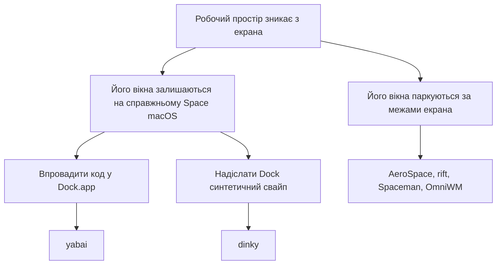

import tierList from "../../../../public/images/blog/macos-tiling-window-managers/tier-list.webp";

Я попрацював із шістьма тайлінговими віконними менеджерами в macOS: yabai зі
skhd, AeroSpace, rift, OmniWM, Spaceman і dinky. Зараз я користуюся dinky. Він
відчувається як частина macOS, якої досі бракувало.

Коротку версію я виклав як
<SourceLink href="https://x.com/exsesx/status/2125644566011265072">тір-лист в X</SourceLink>.
Тут довга: де опинився кожен інструмент і яке інженерне рішення його туди
привело.

<Figure
  src={tierList}
  alt="Тір-лист тайлінгових віконних менеджерів для macOS: dinky у S, rift і Spaceman в A, AeroSpace і yabai в B, у C нікого, OmniWM у D"
  caption="Мій рейтинг станом на 25 листопада 2026 року. Він відповідає на одне питання: що я запустив би сьогодні?"
  frame="intrinsic"
  priority
/>

<Callout title="Що я перевіряв і коли" variant="note">
  Я запускав dinky `0.31`, Spaceman `0.3.5`, rift `0.8.6` та AeroSpace
  `0.21.3-Beta` поруч у macOS `27.2.1` з однією спільною схемою клавіш. yabai та
  OmniWM я оцінював за попереднім досвідом. Цифри з репозиторіїв, посилання на
  код і цитати актуальні на 25 листопада 2026 року.
</Callout>

## Рейтинг

| Рівень | Інструмент    | Чому він тут                                                                                                   |
| ------ | ------------- | -------------------------------------------------------------------------------------------------------------- |
| S      | dinky         | Розкладає вікна на справжніх Spaces macOS, швидко між ними перемикається й залишає SIP увімкненим              |
| A      | rift          | Швидкий і функціональний, з найширшим вибором розкладок серед інструментів із віртуальними робочими просторами |
| A      | Spaceman      | Модель гарячих клавіш, яка мені подобається найбільше, і уважна робота з крайніми випадками                    |
| B      | AeroSpace     | Зробив віртуальні робочі простори популярними. Новіші інструменти розвинули його ідею                          |
| B      | yabai зі skhd | Перший потужний інструмент у цій ніші. Його найкращі можливості досі вимагають послабити SIP                   |
| D      | OmniWM        | Функціональний, але намагається бути цілою оболонкою робочого столу                                            |

Це рейтинг інструментів для щоденної роботи, а не їхньої важливості. yabai і
AeroSpace проклали шлях усьому, що стоїть вище, а в подяках dinky названо обидва.

## Одне питання розставляє всіх шістьох

Куди діваються вікна робочого простору, коли його немає на екрані?

У macOS є власна відповідь, Spaces, але публічного способу керувати ними немає.
Посібник AeroSpace каже про це прямо:
<SourceLink href="https://nikitabobko.github.io/AeroSpace/guide#emulation-of-virtual-workspaces">"Apple не надає публічного API для взаємодії зі Spaces."</SourceLink>
Кожен інструмент тут по-своєму обходить це речення.

Паркування залишає помітний шов. macOS не дає повністю винести вікно за межі
екрана, тому від кожного прихованого вікна залишається смужка завширшки в один
піксель у нижньому куті дисплея. Під час перемикання робочих просторів вікна
переїжджають у цей кут і назад. Це миттєво, бо від macOS потрібне лише
переміщення. Але з погляду macOS усе й далі живе на одному робочому столі.
Mission Control показує всі вікна з усіх робочих просторів одночасно, а
віконний менеджер, який аварійно завершився, залишає свої вікна застряглими за
межами екрана.

У справжнього Space шва немає. Вікна перебувають на іншому робочому столі, у
кутку нічого не чекає, а Mission Control і Cmd-Tab погоджуються з вами щодо
того, де що лежить. Заковика в тому, що Spaces належать Dock, тож треба або
пробратися всередину Dock, або переконати його.

Кожна гілка має свою ціну:

| Інструмент | Робочі простори | SIP                                    | Приватні API                        | Мова           | Перший реліз  |  Зірки |
| ---------- | --------------- | -------------------------------------- | ----------------------------------- | -------------- | ------------- | -----: |
| yabai      | Нативні Spaces  | Частково вимкнено для керування Spaces | SkyLight і код, впроваджений у Dock | C, Objective-C | Червень 2019  | 29 862 |
| AeroSpace  | Віртуальні      | Увімкнено                              | Один символ                         | Swift          | Жовтень 2023  | 23 955 |
| rift       | Віртуальні      | Увімкнено                              | Близько 60 символів SkyLight        | Rust           | Жовтень 2025  |  2 767 |
| OmniWM     | Віртуальні      | Увімкнено                              | SkyLight                            | Swift          | Грудень 2025  |  3 720 |
| Spaceman   | Віртуальні      | Увімкнено                              | Один символ                         | Rust           | Серпень 2026  |    536 |
| dinky      | Нативні Spaces  | Увімкнено                              | SkyLight і синтетичний свайп Dock   | Swift          | Вересень 2026 |    159 |

Цей єдиний символ, `_AXUIElementGetWindow`, зіставляє елемент Accessibility з ID
вікна. Усе інше AeroSpace і Spaceman роблять через публічний Accessibility API.

## yabai і skhd: втручання в Dock

yabai найстаріший у цьому списку: перший реліз вийшов як
<SourceLink href="https://github.com/asmvik/yabai/releases/tag/v1.0.0">v1.0.0 у червні 2019 року</SourceLink>.
Я запускав його зі skhd для гарячих клавіш і з частково вимкненим System
Integrity Protection.

Вимкнений SIP йому потрібен з конкретної причини. Автор у
<SourceLink href="https://github.com/asmvik/yabai/issues/1863">розборі на трекері задач</SourceLink>
пояснює її одним рядком: "Уся система Spaces у macOS реалізована в Dock.app."
З’єднання Dock із WindowServer має розширені привілеї, тому yabai завантажує
scripting addition у процес Dock, щоб скористатися ними. Впровадження живе лише
в пам’яті й не змінює жодного файлу на диску.

Саме це доповнення відкриває можливості з
<SourceLink href="https://github.com/asmvik/yabai/wiki/Disabling-System-Integrity-Protection">розділу вікі про SIP</SourceLink>:
переміщення, створення й видалення Spaces, прозорість і анімації вікон,
закріплені вікна тощо. На Apple silicon за це доводиться вимкнути захист
файлової системи, обмеження налагодження й захист NVRAM, а також додати аргумент
завантаження.

yabai нормально працює з увімкненим SIP, якщо обійтися без цих можливостей, але
саме через них yabai і вибирають. Я запускав його з послабленим SIP, і це
неминуче хоч трохи турбує. Тому він у B.

skhd, невеликий демон гарячих клавіш, у конфігурації якого кожна прив’язка
займає один рядок, природно доповнює yabai, яким можна керувати лише через CLI.
Зараз у README skhd сказано, що репозиторій перебуває в режимі підтримки.

## AeroSpace: взагалі не використовувати Spaces

У 2023 році AeroSpace пішов протилежним шляхом. Він ігнорує нативні Spaces і
<SourceLink href="https://nikitabobko.github.io/AeroSpace/guide#emulation-of-virtual-workspaces">емулює власні робочі простори</SourceLink>:
"якщо робочий простір неактивний, усі його вікна розміщуються за межами видимої
області екрана, у правому або лівому нижньому куті."

macOS не дає вікну повністю вийти за межі екрана, і посібник визнає цей
артефакт: "Ви все одно бачитимете вертикальну лінію завширшки 1 піксель від
'прихованих' вікон." Натомість перемикання миттєве, немає обмеження в 16 Spaces,
а
<SourceLink href="https://github.com/nikitabobko/AeroSpace">README</SourceLink>
може пообіцяти: "AeroSpace ніколи не вимагатиме від вас вимикати SIP."

Посібник навіть радить вимкнути "Displays have separate Spaces": "Spaces у macOS
просто прокляті. Що менше у вас Spaces, то краще поводиться macOS." yabai
вимагає, щоб це налаштування було ввімкнене.

AeroSpace також приніс дерево в стилі i3, конфігурацію в TOML і підхід, де все
починається з CLI, із задокументованим протоколом сокета. Його вплив помітний:
rift і Spaceman так само паркують вікна в нижньому куті, а dinky повторює
команди запитів AeroSpace, щоб скрипти для панелей стану продовжували працювати.
AeroSpace хороший, досі в публічній беті після трьох років, і, як на мене, міг
би бути кращим. Для мене це B.

## rift: приватні API свідомо

rift написано на Rust. Він зберігає модель віртуальних робочих просторів, але
відмовляється від стриманості щодо приватних API. Його
<SourceLink href="https://github.com/acsandmann/rift/blob/main/manifesto.md">маніфест</SourceLink>
називає їх "набагато стабільнішими й надійнішими за публічний (accessibility)
api", а
<SourceLink href="https://github.com/acsandmann/rift/blob/main/src/sys/skylight.rs">`skylight.rs`</SourceLink>
оголошує близько 60 символів SkyLight. SIP залишається ввімкненим. Щодо
нативних Spaces маніфест категоричний: "без вимкнення sip це неможливо." Пізніше
dinky знайшов обхід.

У rift найширший вибір розкладок серед інструментів із віртуальними робочими
просторами: традиційна, BSP, стек, master-stack, прокручувана й плаваюча, і
кожну можна вибрати окремо для робочого простору. Також є індикатор у рядку
меню, жести й гаряче перезавантаження.

rift готується й до власного збою. Віконний менеджер, який паркує вікна за
межами екрана, залишає їх там, якщо аварійно завершується, тому rift запускає
<SourceLink href="https://github.com/acsandmann/rift/blob/main/src/sys/window_recovery.rs#L1-L35">окремий процес відновлення</SourceLink>.
Причину пояснює коментар у коді: "після SIGKILL не виконуються ні деструктори,
ні обробники сигналів."

rift чудовий. У його дорожній карті він досі позначений як бета, і для мене він
ще трохи не дотягує.

## Spaceman: плитка не дорівнює вікну

Spaceman створила Anomaly, команда, що стоїть за OpenCode. Останнім часом вона
випустила кілька класних програм, зокрема Hex і Rune.

Spaceman починається з багу, на який натрапляєш лише з нативними вкладками.
<SourceLink href="https://github.com/anomalyco/spaceman/blob/4c1df8b71e9a0ea2a95fc790144ea15d728f1273/PLAN.md">План</SourceLink>
проєкту описує його так: вибір вкладки Ghostty "відкриває іншу
Accessibility-ідентичність вікна, хоча користувач і далі бачить одне вікно
термінала." Віконний менеджер, який вважає кожну таку ідентичність окремою
плиткою, може розділити ваш термінал навпіл.

Spaceman розділяє ці два поняття. Логічний слот "займає одне місце в розкладці,
а його поточну фізичну прив’язку до `AXWindow` можна замінити." Коли перемикання
вкладки підміняє вікно під ним, слот зберігає своє місце, розмір і робочий
простір.

Вікна Spaceman паркує так само, як AeroSpace, але ретельніше. Згідно з
<SourceLink href="https://github.com/anomalyco/spaceman/blob/4c1df8b71e9a0ea2a95fc790144ea15d728f1273/docs/features/workspaces.md">нотатками про робочі простори</SourceLink>,
початкове положення й розмір вікна записуються в `parked-windows.json` до того,
як вікно переміститься. Під час перемикання спершу з’являються вікна нового
робочого простору, а потім паркуються вікна попереднього, тож порожній робочий
стіл ніколи не блимає. Якщо віконний сервер не підтвердить появу вікон протягом
300 мс, перемикання відкочується. У гілці розробки вікно, яке двічі за п’ять
хвилин саме повертається з паркування, стає
<SourceLink href="https://github.com/anomalyco/spaceman/blob/4c1df8b71e9a0ea2a95fc790144ea15d728f1273/docs/compatibility.md">виключеним із паркування</SourceLink>
до кінця сесії й залишається видимим.

Схему гарячих клавіш Spaceman я переніс усюди: один базовий модифікатор, а кожна
дія переміщення використовує те саме поєднання плюс Shift.

В A його тримають дві речі. Він швидкий, але все одно відчувається трохи менш
нативним, ніж справжні Spaces. І в ньому немає розкладки-акордеона, а цей режим,
як на мене, чудовий. Коли Spaceman його додасть, він стане моїм першим вибором
після dinky. Уже зараз я перейшов би саме на нього, якщо Apple якось зламає
dinky.

## OmniWM: програма для всього

OmniWM у D, хоча це не погана програма. У неї активна спільнота, а її
<SourceLink href="https://github.com/OmniNull/OmniWM/blob/main/website/src/content/docs/developers/architecture.md">документація для розробників</SourceLink>
описує серйозну архітектуру: єдиний шлях фіксації змін для всього стану й плани
розкладки, які відкидаються, коли застарівають.

Моя проблема в масштабі. У
<SourceLink href="https://github.com/OmniNull/OmniWM/blob/main/README.md">README</SourceLink>
перелічено чотирнадцять головних можливостей, і тайлінгу стосуються лише дві з
них. Серед решти є перемикач вікон, термінал у стилі Quake на основі Ghostty,
оформлення програм, палітра команд, приховування піктограм у рядку меню,
"подібне до Ice", функція, що не дає комп’ютеру заснути, "подібна до Caffeine",
та інтерактивна панель робочих просторів. Документація додає історію буфера
обміну, Dynamic Island і оболонку робочого столу з підтримкою скриптів та 29
віджетами за замовчуванням.

У мене вже є лаунчер і термінал, які я вибрав свідомо. Від віконного менеджера я
хочу, щоб він рухав прямокутники. OmniWM підійде тому, хто хоче, щоб одна
програма керувала всім робочим столом. Це не я, тому я його видалив.

## dinky: справжні Spaces, SIP увімкнено

dinky робить те, що маніфест rift назвав неможливим. Він розкладає вікна на
нативних Spaces, швидко перемикається між ними й
<SourceLink href="https://dinky.rodeo/">нічого не впроваджує в Dock</SourceLink>.

Секрет у тому, що dinky передає Dock подію введення. Він надсилає синтетичний
свайп Dock, тобто подію, яку створює свайп трекпадом між Spaces. У macOS 27
швидкість цього свайпа достатня, щоб Dock пропустив анімацію ковзання. На сайті
результат оцінюють як "близько 70 мс замість пів секунди."

Це число походить із
<SourceLink href="https://github.com/mikker/Dinky/blob/93eaac5ce57eaa8ad2932698f4602c03606f82eb/RESULTS.md">нотаток автора з вимірюваннями</SourceLink>:
медіана 66 мс для свайпа проти 558 мс для синтетичного натискання Control зі
стрілкою, у віртуальній машині, до моменту, коли система повідомляє про новий
Space. Пізніший запуск на реальному залізі з увімкненим SIP і двома дисплеями
зафіксував від 93 до 176 мс за десять перемикань. На моєму Mac перемикання гарячою
клавішею відчувається миттєвим.

Коментарі в коді пояснюють налаштування. На старіших версіях macOS швидкість
свайпа зафіксовано на 50, і
<SourceLink href="https://github.com/mikker/Dinky/blob/93eaac5ce57eaa8ad2932698f4602c03606f82eb/Sources/DinkyPrivate/switch.m#L94-L101">причину записано</SourceLink>:
"При 200 і більше macOS пропускає анімацію й так і не повідомляє вікнам Space,
на який переходить, що вони знову видимі, тож програми, які перестають малювати,
поки приховані, як-от Ghostty, залишаються порожніми." dinky також позначає
власні синтетичні події байтами `0x44494E4B`, тобто "DINK" в ASCII, тож ніколи
не плутає їх із вашими свайпами.

Друга половина роботи полягає в переміщенні вікна між Spaces. Фреймворк Apple
SkyLight не експортує потрібну dinky функцію, тому dinky
<SourceLink href="https://github.com/mikker/Dinky/blob/93eaac5ce57eaa8ad2932698f4602c03606f82eb/Sources/DinkyPrivate/skylight.m">перебирає таблицю символів фреймворку під час виконання</SourceLink>,
щоб її знайти. У macOS 27 він також створює й видаляє Spaces відповідно до
кількості ваших робочих просторів. У macOS 26 він відмовляється це робити після
<SourceLink href="https://github.com/mikker/Dinky/issues/87">повідомлення про помилку</SourceLink>,
коли в Dock залишився фантомний робочий стіл.

У щоденній роботі саме це дає dinky S:

- Mission Control, Dock і Cmd-Tab бачать ті самі робочі простори, що й я.
- Нічого не паркується за межами екрана, тож у куті немає смужки, а після збою
  немає вікон, які можуть там застрягнути.
- Є режим акордеона, прокручувана розкладка й розкладка master.
- Дрібниці зроблено правильно: анімації вікон і нормальна піктограма програми
  для темної теми.

Автор прямо пише про стан проєкту: "ранній етап, автор щодня використовує його
в macOS 27. Очікуйте шорсткостей." Іноді я бачу мерехтіння під час перемикання
Space і підозрюю, що це macOS перемальовує робочий стіл. Cmd-Tab до програми на
іншому Space працює повільніше, ніж пряма гаряча клавіша, бо macOS спершу
активує програму, а dinky підлаштовується слідом. Повноекранного режиму без
відступів немає. І вся конструкція тримається на приватних викликах. Сайт про це
каже: "Оновлення macOS може їх зламати."

Мене такий компроміс влаштовує. dinky два місяці, і за 59 днів він випустив 33
релізи.

## Почесна згадка: FlashSpace

<SourceLink href="https://github.com/wojciech-kulik/FlashSpace">FlashSpace</SourceLink>
немає в тір-листі, бо це не віконний менеджер. У README його названо "менеджером
віртуальних робочих просторів", і на питання про приховування він відповідає
четвертим способом: ховає програми. Ви прив’язуєте програми до робочих
просторів, а під час перемикання FlashSpace показує їх і ховає решту штатним
приховуванням macOS, тим самим, що стоїть за Cmd-H.

Компроміс описано в README під окремим заголовком "Немає підтримки окремих вікон
програми для кожного робочого простору". Приховування діє на всю програму, тож
усі її вікна зникають разом. Причиною названо "відсутність у macOS публічного
API для приховування окремих вікон." Натомість у кутку нічого не паркується, а
README може назвати цей підхід "вільним від хаків" і сказати, що він "не ламає
інші функції системи, як-от Mission Control."

FlashSpace довго був моїм основним інструментом, і я досі вважаю його чудовим.
Раз уже я роздаю оцінки, скажу: я робив внески і у FlashSpace, і в rift.

## На чому я зупинився

dinky тепер мій основний інструмент. rift і Spaceman залишаються встановленими,
а AeroSpace і yabai зберігають мою повагу й місце в репозиторії з
конфігурацією.

Усі чотири конфігурації мають спільну схему клавіш, тож зміна інструмента коштує
одного запуску програми. Це моя страховка від ризиків приватних API: якщо
оновлення macOS зламає dinky, Spaceman буде на відстані одного кліку, і нічого
не доведеться вчити заново.

Застереження стосується часу. Двох із цих шести інструментів чотири місяці тому
ще не існувало, а dinky лише два місяці. Подивлюся, який інструмент досі
здаватиметься правильним після кількох оновлень macOS.

## Джерела

- <SourceLink href="https://dinky.rodeo/">Документація dinky</SourceLink>
- <SourceLink href="https://github.com/mikker/Dinky">Код dinky</SourceLink>
- <SourceLink href="https://github.com/mikker/Dinky/blob/93eaac5ce57eaa8ad2932698f4602c03606f82eb/RESULTS.md">dinky: нотатки з вимірюваннями</SourceLink>
- <SourceLink href="https://github.com/anomalyco/spaceman">Код Spaceman</SourceLink>
- <SourceLink href="https://github.com/anomalyco/spaceman/blob/4c1df8b71e9a0ea2a95fc790144ea15d728f1273/PLAN.md">Spaceman: план і логічні слоти</SourceLink>
- <SourceLink href="https://github.com/acsandmann/rift">Код rift</SourceLink>
- <SourceLink href="https://github.com/acsandmann/rift/blob/main/manifesto.md">rift: маніфест</SourceLink>
- <SourceLink href="https://nikitabobko.github.io/AeroSpace/guide">Посібник AeroSpace</SourceLink>
- <SourceLink href="https://github.com/nikitabobko/AeroSpace">Код AeroSpace</SourceLink>
- <SourceLink href="https://github.com/asmvik/yabai">Код yabai</SourceLink>
- <SourceLink href="https://github.com/asmvik/yabai/wiki/Disabling-System-Integrity-Protection">yabai: вимкнення System Integrity Protection</SourceLink>
- <SourceLink href="https://github.com/asmvik/yabai/issues/1863">yabai: як працює scripting addition</SourceLink>
- <SourceLink href="https://github.com/asmvik/skhd">Код skhd</SourceLink>
- <SourceLink href="https://github.com/OmniNull/OmniWM">Код OmniWM</SourceLink>
- <SourceLink href="https://github.com/wojciech-kulik/FlashSpace">Код FlashSpace</SourceLink>
